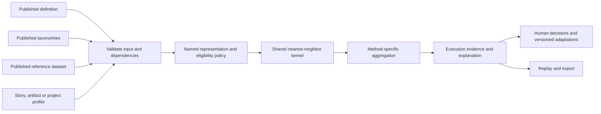

# US-Agent: Configurable and Traceable KNN Recommenders for Software Engineering

## Abstract

Software-engineering recommenders often combine domain-specific attributes, taxonomies, historical cases, and recommendation policies in a single implementation. This coupling makes it difficult to configure another artifact type while preserving the behavior and provenance of an existing method. US-Agent separates versioned recommender definitions, taxonomy and dataset publications, method policies, execution evidence, and human assessments. We describe three implemented configurations: non-functional requirements, a test-case equation demonstration, and project risks without user stories. A configurable project feature changes representation and neighbor selection without a dedicated application-code field. A technical evaluation repeats 23 preserved conditions, including blocked, empty, and deliberate failure cases, and retains all eight NFR compatibility outputs. Additional local checks exercise organization isolation, role enforcement, audit records, and immutable NFR adaptation. These results support technical feasibility in the implemented scope. Empirical recommendation relevance, classification-error propagation, and participant configuration effort have not been measured. A versioned three-task protocol and evidence-verification tool prepare those evaluations without treating synthetic fixtures as human observations.

Keywords: software-engineering recommendation; KNN; configurable systems; provenance; human review.

## 1. Problem and contribution

An NFR recommender may depend on a user story, functional labels, project technologies, tasks, and historical NFR associations. Recommending test cases changes the relevant attributes, artifact representation and item aggregation. Recommending risks from a project profile removes the user-story dependency. Adding another screen does not by itself separate those concerns.

US-Agent addresses this engineering problem by making the input contract and its published dependencies explicit. The contribution evaluated here is an implemented configuration and traceability mechanism, accompanied by three technical examples. We do not claim a new nearest-neighbor algorithm, measured superiority over the referenced systems, or a faithful reproduction of every published experiment.

The examples draw on NFR recommendation described by Ramos, test-case recommendation described by Dilorenzo and colleagues, and the project-profile motivation of ARISE. Their available sources and unresolved reproduction questions are recorded in the project's reference matrix [1]. Method differences are retained as named policies rather than normalized into an undocumented common formula.

## 2. Architecture and configuration contract

The application uses a React interface, an Express/TypeScript API, and PostgreSQL. A definition identifies the artifact type, attributes, value types, cardinalities, scopes, roles and method parameters. Attribute roles distinguish features from context, filters and output. A text field does not automatically acquire a distance representation. Publication rejects capabilities unsupported by the selected method.

Independent taxonomy publications represent lists or trees with stable node IDs, descriptions and selection rules. Attribute bindings refer to a precise taxonomy ID, version, hash format and SHA-256 hash. A display-name match is not an ID equivalence. Non-selectable nodes remain visible as organizers or preserved inactive items without becoming legal input values.

CSV/JSON import retains the original file and reports field/record errors. Publication requires explicit treatment of invalid records. A reference dataset is selected explicitly, rather than inferred from the current operational history. Published definitions, taxonomies, datasets and test catalogs remain immutable; retirement prevents new selections while preserving historical access and replay.

The shared kernel performs neighbor selection while named policies define representation, eligibility, tie-breaking and aggregation. An execution retains its input, publications, candidate decisions, distances, selected neighbors, items, method/adapter versions, and runtime identity. Replay recomputes preserved inputs and compares result, explanation and projection with their original snapshots.

## 3. Three technical configurations

### 3.1 Non-functional requirements

The compatibility policy `ramos_2019_manhattan_k1_v2` retains target-derived binary dimensions, normalized Manhattan comparison, k=1, functional module/operation eligibility and prototype exclusion. Existing tie-breaking and missing-data behavior remain explicit implementation policies. The nearest neighbor is not replaced merely because it has no eligible NFR item. Imported or manually supplied labels can be used without rerunning an LLM.

Human acceptance/rejection is stored separately from the original recommendation. An accepted item can be adapted for its confirmed destination. Each adaptation preserves the original item, decision and target references, a reason, author, revision and parent hash. It does not overwrite the run, published dataset or operational story. Revising a copy appends evidence; it does not revise a historical scientific result.

### 3.2 Test-case equation demonstration

The test example uses its own published catalog, acceptance-criteria taxonomy, attributes, dataset and item artifacts. It preserves original test text and supports assessment and versioned copies. The implemented equation demonstration uses a separately identified policy. Available source descriptions contain unresolved questions about the transformation between Euclidean distance and similarity, data linkage and experimental population [1]. Therefore this configuration demonstrates execution of explicit equations and the common workflow; it is not reported as a reproduction of the original TestRec experiment.

### 3.3 Project risks without user stories

The project configuration uses categorical project attributes and a named weighted-Manhattan binary representation. Feature vocabulary, weights and neighbor limit are read from configuration. The example publishes synthetic profile–risk associations and accepts an input without a story, sprint, functional classification or invented classification ID.

Two preserved version-2 conditions use the same definition, reference dataset and input identity and differ in `team_distribution`. The changed configured feature changes the selected neighbor. This illustrates participation in calculation, not merely form customization. Comparing version 1 with version 2 would also change k and vocabulary and would not isolate the attribute's effect. Numeric representations, generic filters and additional method policies are outside the implemented scope.

## 4. Access, authorship and legacy continuity

Authenticated organization membership determines an actor's role and domain schema. Viewers read, reviewers assess, maintainers configure/run, and administrators additionally manage memberships and inspect audit records. Domain queries use transaction-local schema and actor settings with no fallback to another organization's domain schema. Login identities and memberships are resolved from the central registry. A missing registry or missing membership fails closed in production.

The original workspace remains in its original schema. Existing users retain their previous effective access at migration time; subsequent grants and revocations are explicit. Separate organizations are provisioned into separately migrated schemas. This application-level isolation does not claim protection against a database administrator or a compromised server credential.

Append-only audit events record the actor, table, operation, row identity, transaction and before/after hashes without copying full domain content or credentials into the audit log. Historical authorship is not retroactively assigned to a person. Legacy WIS migration stages drafts and preserves original IDs, hierarchy, activity, order and a source snapshot; it does not silently replace the classifier's existing catalog.

## 5. Technical evaluation

The evaluation unit is a preserved scenario/input condition. Conditions may share inputs or data and are not independent experimental samples. Each condition is repeated twice using the existing evaluators and exact method inputs. The integrated package records a deterministic report, manifest, CSV and replay artifacts [2].

| Example | Conditions | Completed | Blocked | No candidates | No items | Deliberate technical failure |
| --- | ---: | ---: | ---: | ---: | ---: | ---: |
| NFR | 13 | 8 | 1 | 1 | 2 | 1 |
| Tests | 6 | 3 | 1 | 0 | 1 | 1 |
| Risks | 4 | 4 | 0 | 0 | 0 | 0 |

The integrated technical gate passed, all eight NFR compatibility results remained unchanged, and the four risk conditions retained result, explanation and projection. Empty/blocked outcomes and deliberate failures were retained rather than removed from the report. The deterministic report hash was `40ec09df722e799c02afc27f03a36d8f586f805b5b2edc1b853f2ae991b60871` in this execution.

Local software verification also passed 154 API tests and 65 web tests. HTTP/PostgreSQL checks exercised concurrent cross-organization requests, immediate membership revocation, last-administrator protection, author attribution, immutable audit evidence, and the NFR adaptation chain. These are software-verification results, not participant observations, recommendation precision/recall or a production-availability measurement.

## 6. Prepared empirical evaluation and validity limits

Protocol v3 specifies guided configuration tasks for all three examples, fresh namespaces, separate training, proposed task-order balancing, explicit start/finish and pause rules, error/help/code-change logs, artifact checkpoints and actual exported evidence [3]. A review record is required before observed collection. The tool checks file bytes, snapshot integrity, publication/run linkage, and replay reports; it cannot certify human authenticity, consent, independent judgment or academic approval.

The observed-session register currently contains zero sessions. Completion estimates and timing medians are null, not zero-valued performance measurements. Proposed recruitment/sample choices require review before collection. Incomplete, abandoned and not-started attempts must remain in their declared denominators, and repeated sessions from the same participant must not be treated as independent people.

Empirical recommendation evaluation additionally requires authorized target data, independent relevance judgments, justified grouping/folds, and a fixed tuning policy. Classification effects require actual paired reference, predicted and reviewed labels under the same definition/base and reference items. Consensus and confidence are not substitutes for prediction accuracy. Project-risk configuration has no functional-story classification step; the classification condition is not applicable.

Internal validity is limited by synthetic/reconstructed associations and known source ambiguities. External validity is limited by the supported representations and the absence of participant or representative-load data. Construct validity requires separating technical repeatability, human acceptance, independent relevance and configuration effort. Recorded in-process timings do not measure human effort or deployment latency. No production deployment was performed for the reported increment.

## 7. Conclusion

US-Agent implements a shared configuration/publication/execution workflow for three technically distinct KNN examples while preserving method-specific behavior and execution evidence. The project-only example demonstrates an additional configured feature participating in calculation without a dedicated domain-code field. Human assessments and adaptations remain separate from raw recommendations, and access/audit mechanisms preserve responsibility for later changes. Technical verification supports these bounded claims. Empirical relevance, classification propagation and participant effort remain unmeasured and require the prepared study to be executed with real, reviewed evidence.

## References and artifacts

1. [Reference and methodological-fidelity matrix](../referencias-e-fidelidade.md). Includes Ramos (2019), *Recomendação de Requisitos Não Funcionais em Projetos Ágeis Baseados em Scrum*; Souza Filho (2021), *Uma Abordagem para Recomendação de Casos de Teste em Projetos Ágeis Baseados no Scrum*; the IEEE Access NFR article, DOI `10.1109/ACCESS.2025.3548631`; the SAC test-case article, DOI `10.1145/3748522.3779891`; and ARISE, DOI `10.1016/j.jss.2026.112987`. Bibliographic metadata and reproduction limits are those already recorded in the local source review.
2. [Integrated technical evaluation and reproduction commands](../avaliacao-integrada.md); [three-example tutorial](../tutorial-three-recommenders.md); [implemented architecture](../arquitetura-executada.md).
3. [Three-method configuration protocol](../../research/configuration-effort-v3/protocol.md); [execution and collection guide](../estudo-tres-casos-v3.md).
