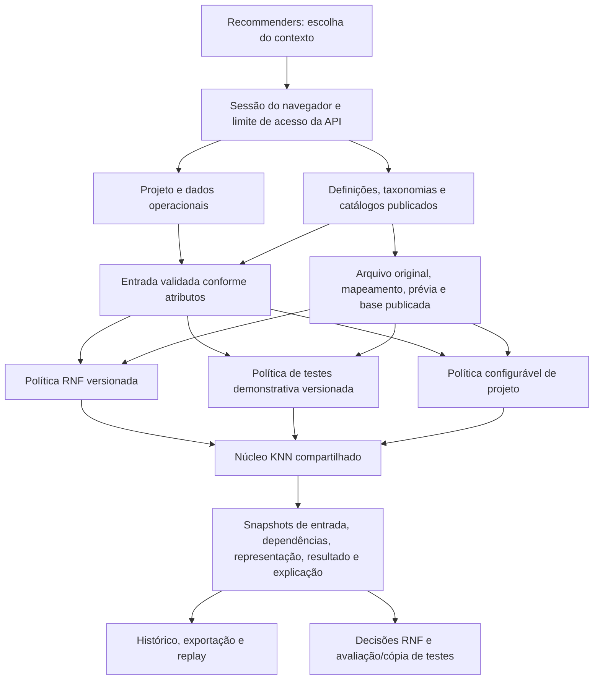

# Arquitetura executada dos três recomendadores

Estado técnico após 038; consolidação B23 em 039. Esta descrição trata do software implementado, sem transformar as tabelas/serviços em garantias de avaliação empírica ou isolamento organizacional.

## Componentes reais

| Responsabilidade | Implementação |
| --- | --- |
| Entrada HTTP e proteção | `apps/api/src/app.ts`, `security/web-sessions.ts`, `security/api-boundary.ts`; a aplicação web não recebe a chave de integração. |
| Escolha e contexto | `RecommendersPage.tsx`; RNFs/testes usam o contexto da história no fluxo de projeto, riscos usam perfil sem história. A área de bases mantém execução manual. |
| Projeto antes da classificação | `project-stories.ts`, `story-preparation.ts`; identidade estável, revisão de alterações e cópia dos detalhes na classificação. |
| Definição e atributos | `domain/recommender-definition.ts`, editores de definição/taxonomia e contratos de publicação. A definição identifica explicitamente seu método versionado. |
| Ciclo compartilhado | `recommender-definitions.ts`, `recommender-datasets.ts`, `recommendation-runs.ts`; arquivo, prévia, versões, hashes e publicação imutável. |
| Extensão para perfis | `routes/configurable-recommendations.ts`, `publish-configurable-definition.ts`, `configurable-runs.ts`; estendem os endpoints/tabelas existentes e preservam os executores históricos. |
| Perfis adicionais | `configurable-project-profiles.ts`, tabela `project_recommender_profiles`; valores por projeto/versão com revisão otimista e ponte inicial de fontes compatíveis. |
| Algoritmo comum | `services/knn.ts` recebe a política de dimensões, elegibilidade, vetores, medida e desempate; a política continua responsável pela agregação dos itens. |
| Evidência persistida | `recommender_runs`; esquema 1 para RNF, 2 para testes e 3 para perfis, com validação e hashes das partes. |
| Consolidação offline | `scripts/evaluate-integrated.ts` reutiliza os dois avaliadores e o executor de perfis com entradas preservadas, sem acesso à API/banco. |

Os nomes de rotas/arquivos e os identificadores históricos de métodos são contratos técnicos; a interface de operação usa nomes neutros. Referências bibliográficas permanecem na documentação científica e não são explicações de produto.

## O que cada método permite configurar

| Dimensão | RNF | Testes | Projeto |
| --- | --- | --- | --- |
| Entrada | Rótulos, perfil e tarefas conforme vínculos do adaptador | Características e catálogo conforme vínculos | Atributos categóricos de projeto com papel de característica; contexto separado |
| Representação | Presença nas dimensões do alvo | Presença nas dimensões do alvo | Presença simétrica no vocabulário do alvo e da base |
| Distância e k | Manhattan normalizada, k=1 fixo | Demonstração Manhattan, k=3 fixo | Manhattan ponderada; k de 1 a 100 e pesos positivos por característica |
| Filtros | Política funcional/protótipos preservada | Política demonstrativa e identidade da história | Exclusão por ID de registro idêntico; filtros adicionais não implementados |
| Agregação | Itens do vizinho, sem substituição por falta de saída | Regra demonstrativa, artefatos do catálogo | União de textos dos vizinhos, suporte por vizinho e atributo de saída |
| Atributo adicional | Contexto, sem alterar a política histórica | Contexto, sem alterar vínculos científicos fixos | Nova característica categórica participa do cálculo sem código específico |
| Referência | Publicação escolhida ou histórico operacional explicitamente selecionado | Base e catálogo publicados e exatos | Base publicada exata |

Os três não são três implementações completas de KNN independentes: compartilham o ranqueador, mas conservam políticas distintas. Tampouco qualquer atributo de qualquer tipo entra automaticamente no cálculo. No método de projeto, texto livre, números e registros não têm codificação de característica implementada; contexto pode preservá-los. Saídas são listas de texto, não uma ontologia genérica de riscos.

## Rastreabilidade e concorrência

Publicação válida associa versões e hashes das dependências; o conteúdo publicado é imutável e uma alteração exige nova versão. A importação guarda bytes do arquivo e seus próprios hashes, diferentes dos hashes do JSON normalizado. Registros inválidos e duplicados são apresentados na prévia; exclusões são explícitas.

Uma execução guarda pedido, entrada, definição, base e catálogo quando aplicável, representação, resultado, explicação e versões de software. Repetir o mesmo ID/pedido é idempotente; trocar o conteúdo com o mesmo ID recebe conflito. O replay histórico não lê o estado corrente do perfil nem substitui dependências por versões recentes.

Histórias preparadas e perfis adicionais usam revisões para recusar alterações desatualizadas. As decisões humanas permanecem fora do resultado bruto e não reescrevem a base de referência. Perfis de risco ainda não têm decisão/adaptação operacional persistida.

## Operação e limites atuais

As migrations 027/028 devem preceder o código novo. A 028 permite o esquema 3 na tabela de execuções e cria os perfis adicionais; não publica uma definição ou base por conta própria. A validação da entrega 038 ocorreu em branch temporária, depois removida. Esta consolidação não verifica nem atualiza o deployment atual.

Contas e sessões não equivalem a isolamento de organizações: o espaço é compartilhado e B13 continua parcial por papéis, autoria/auditoria de domínio e autorização organizacional. Classificação web e CLI Python têm políticas próprias; o ensaio integrado não os intercambia nem avalia modelos externos.

A [fidelidade](referencias-e-fidelidade.md), o [contrato do perfil](recomendador-projeto-configuravel.md) e o [protocolo integrado](../research/integrated-demonstration-v1/protocol.md) separam compatibilidade, demonstrações e avaliação ainda necessária. O [tutorial](tutorial-three-recommenders.md) cobre operação; o instrumento de esforço v2 permanece vinculado somente aos seus dois exercícios históricos, sem coleta humana presumida.
