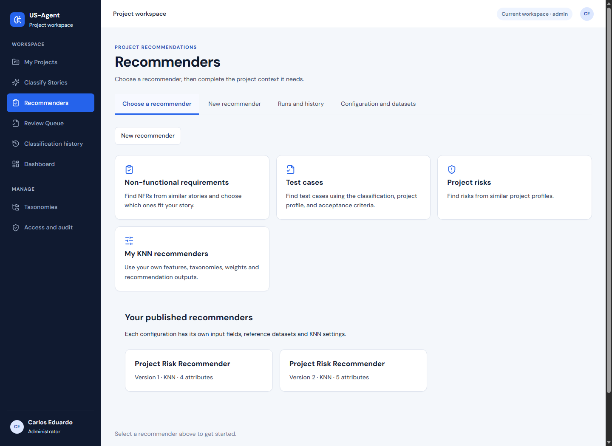
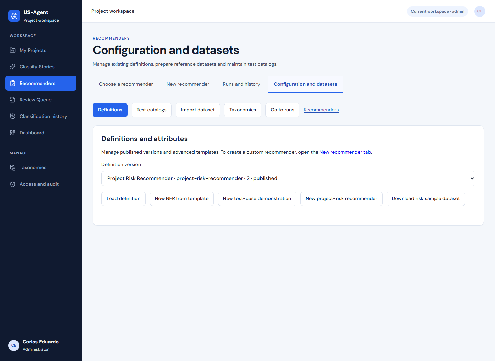
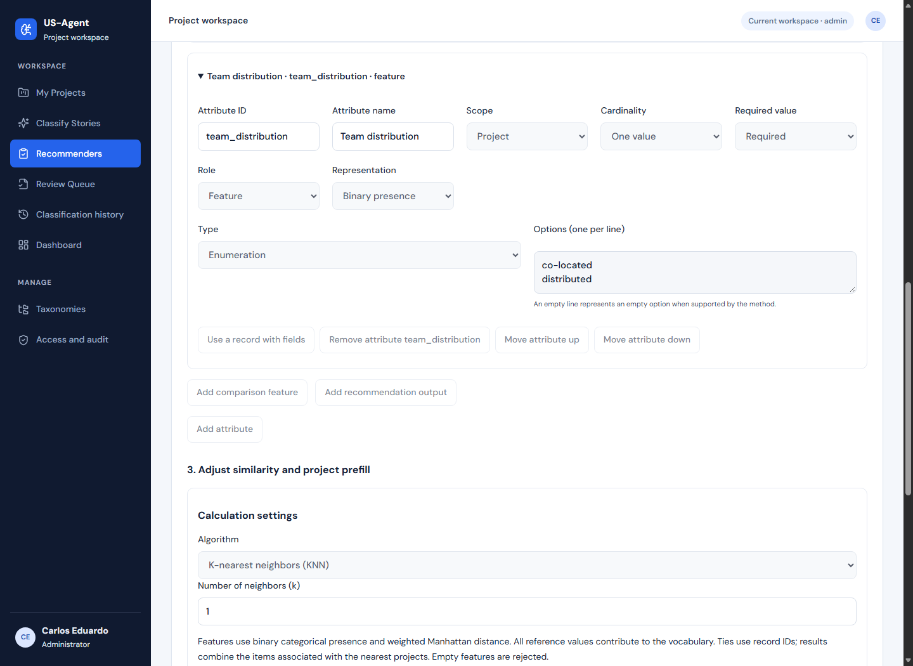
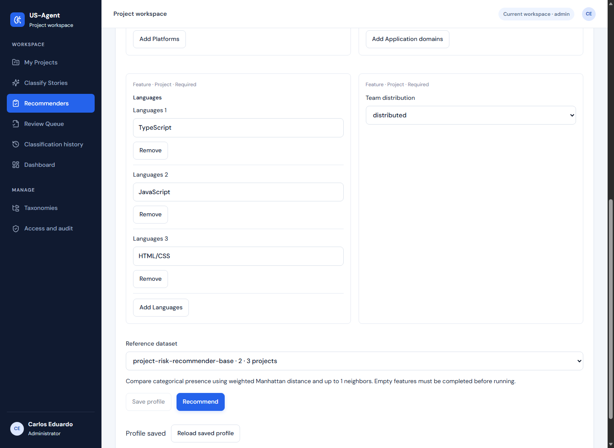
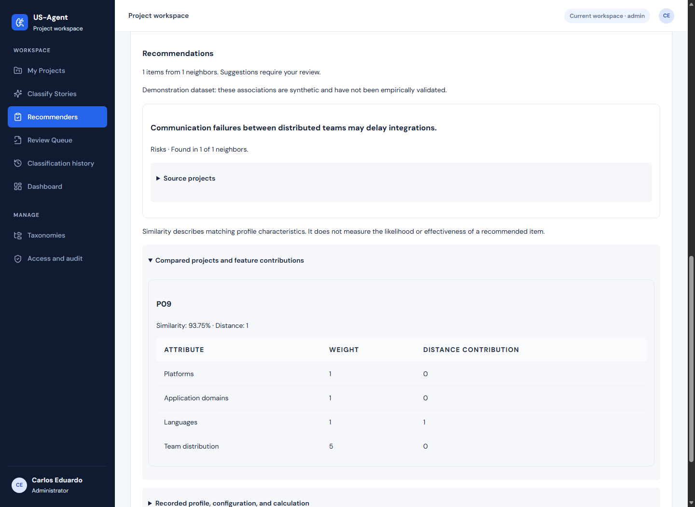
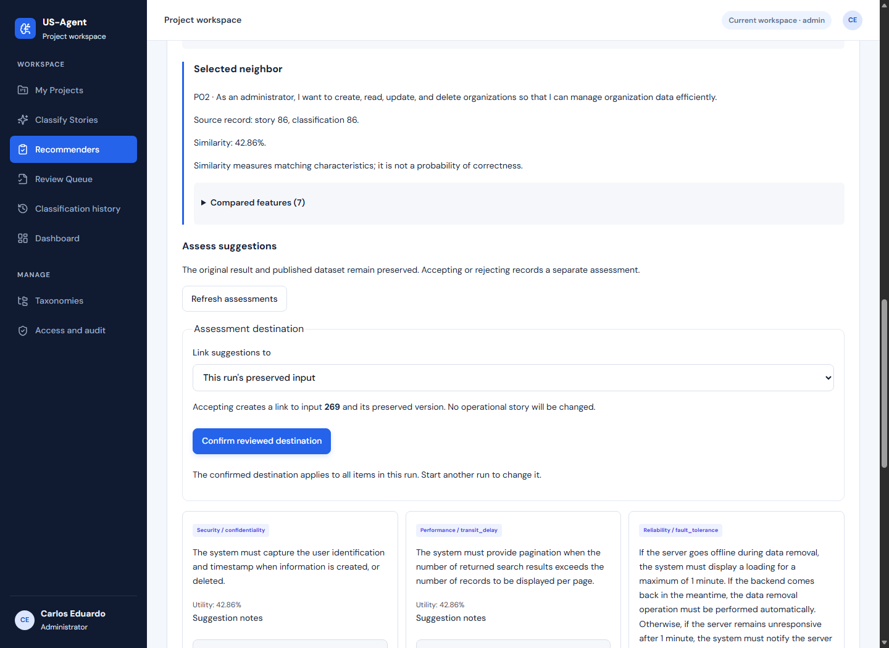
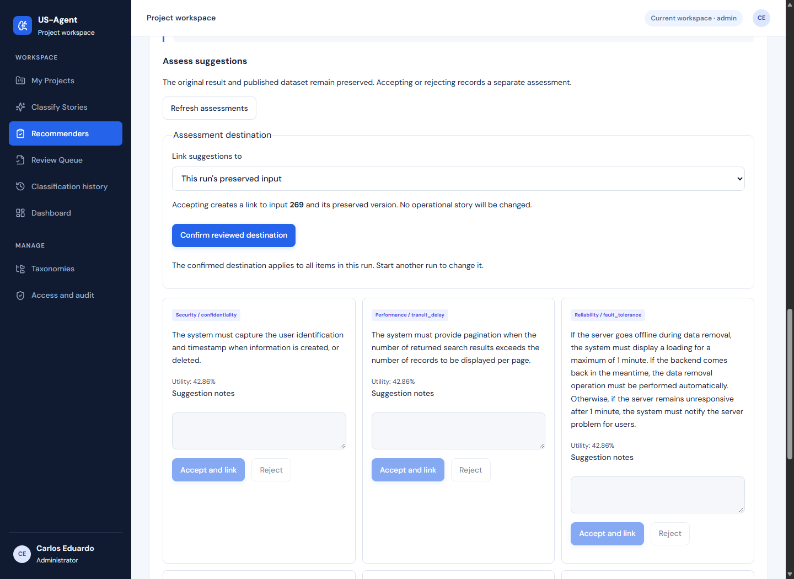
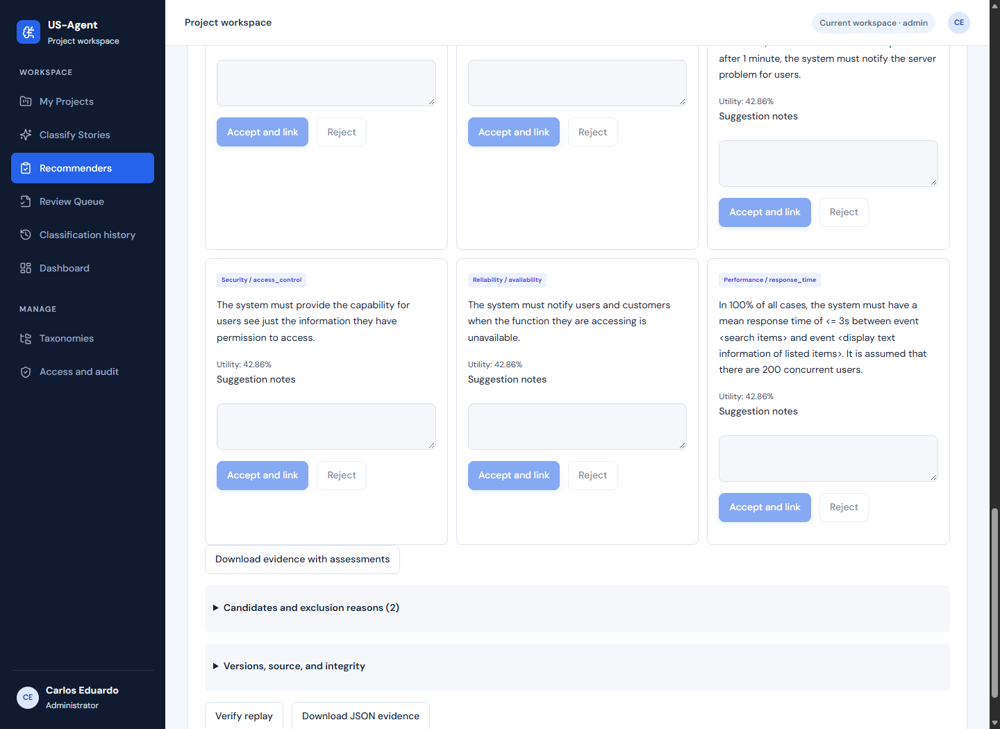
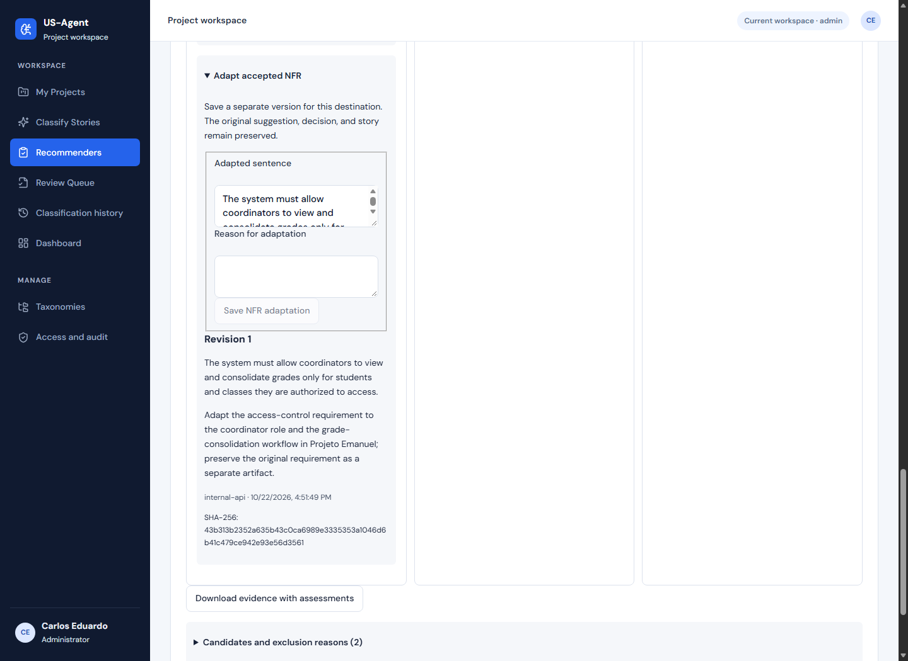
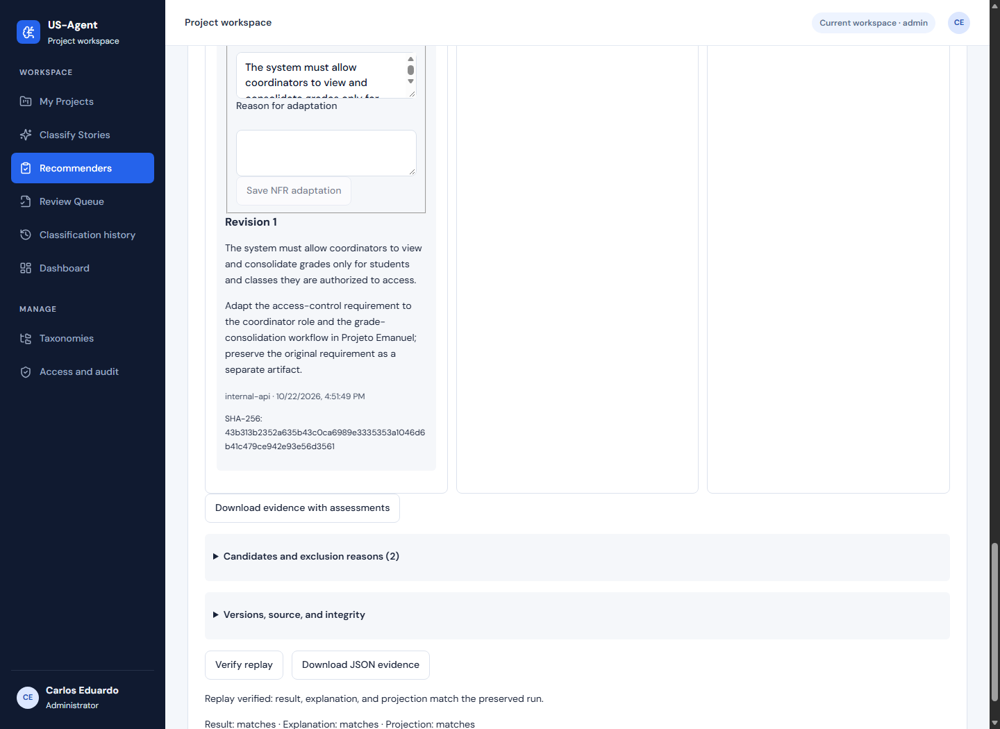

# Guia correto da demonstração — passo a passo com prints

Siga os passos de 1 a 11, na ordem. Mantenha este guia aberto e use os links “Abrir” para trabalhar em outra aba da aplicação. No HTML, todos esses links reutilizam a mesma aba.

Você vai mostrar uma configuração pronta, executar duas consultas de riscos, aceitar e adaptar um RNF e baixar a evidência. As configurações e bases já foram publicadas: não é necessário criar, importar ou publicar novamente.

Este roteiro de 4min30 apresenta a configuração já criada. Ele não filma a criação/importação ao vivo. A diferença está indicada para você não narrar uma consulta como se estivesse criando uma publicação naquele instante.

Faça a primeira leitura sem clicar nos botões de aceitar ou salvar. Reserve essas ações para a apresentação: elas ficam registradas.

Conferido em 23/10/2026, 08:13 (Fortaleza).

Os prints mostram a interface publicada renderizada localmente com dados de produção em modo de leitura. O login pessoal não foi testado. Nenhum dado foi alterado em produção nesta revisão.

## 1. Mostre o que a ferramenta oferece — 0:00–0:30

[Abrir Recommenders](https://us-agent-api.vercel.app/recommendations)

1. Abra o link desta etapa. Entre com seu login habitual se aparecer a tela de acesso.
2. Aponte para Non-functional requirements, Test cases e Project risks, nesta ordem.
3. Fique nessa tela. Você não precisa clicar em Test cases; este roteiro executará riscos e RNFs.



As três opções principais aparecem na primeira linha. A quarta opção é para recomendadores próprios.

**Resultado esperado:** Você vê a tela Recommenders, com as três opções principais e os cartões Project Risk Recommender abaixo.

**Fala sugerida:** “A ferramenta reutiliza conhecimento de projetos e histórias para recomendar requisitos não funcionais, casos de teste e riscos. Vou mostrar uma comparação de perfis e depois adaptar um requisito.”

## 2. Abra a configuração que já está publicada — 0:30–1:05

[Abrir Configuration and datasets](https://us-agent-api.vercel.app/recommender-setup)

1. Abra o link desta etapa e clique em Definitions, se essa aba não estiver selecionada.
2. No campo Definition version, escolha Project Risk Recommender · project-risk-recommender · 2 · published.
3. Clique em Load definition.
4. Confira ID = project-risk-recommender, Version = 2, Name = Project Risk Recommender e State: published.



Escolha o item que contém project-risk-recommender, versão 2 e estado published. Não escolha demo-video nem retired.

**Resultado esperado:** A definição abre em modo de consulta. Os campos ficam desabilitados porque a versão já foi publicada.

**Fala sugerida:** “Esta configuração já está publicada. Ela declara as características usadas para comparar projetos e a saída que será recomendada.”

## 3. Mostre o campo que influencia a comparação — 1:05–1:40

Continue na mesma página da etapa anterior.

1. Continue na mesma página. Role até Attributes (5).
2. Clique no título Team distribution · team_distribution · feature para expandir.
3. Aponte para Role = Feature e para as opções co-located e distributed.
4. Role mais abaixo até Calculation settings. Confira Number of neighbors (k) = 1 e Weight for Team distribution = 5. Os outros três pesos são 1.



Team distribution está configurado como Feature e oferece duas opções: co-located e distributed.

**Resultado esperado:** O novo campo faz parte do cálculo. Você está apenas mostrando a configuração; não precisa criar outra versão ou publicar nada.

**Fala sugerida:** “A distribuição da equipe foi acrescentada como característica de comparação. Seu peso é cinco, e a consulta seleciona um vizinho. Agora vou mudar o valor desse campo na entrada.”

## 4. Execute a consulta com equipe distribuída — 1:40–2:00

[Abrir consulta de riscos já preenchida](https://us-agent-api.vercel.app/configured-recommendations?definitionId=project-risk-recommender&definitionVersion=2&datasetId=project-risk-recommender-base&datasetVersion=2&project=Information%20Resources%20Web%20Project)

1. Abra o link desta etapa. Ele carrega a versão 2 e o perfil do Information Resources Web Project.
2. Confira Platforms = Web; Application domains = Information resources; Languages = TypeScript, JavaScript e HTML/CSS, em três valores separados.
3. No campo Team distribution, selecione distributed.
4. Em Reference dataset, confira project-risk-recommender-base · 2 · 3 projects.
5. Clique uma vez no botão azul Recommend e espere a execução terminar. A página abrirá o histórico com seu resultado; role para baixo até Recommendations.



O campo Team distribution e o botão azul Recommend aparecem na parte inferior do formulário.

**Resultado esperado:** A execução termina sem erro e mostra uma recomendação de risco. Não edite as linguagens, o domínio ou a base.

## 5. Mostre por que o resultado veio do P09 — 2:00–2:20

Continue na mesma página da etapa anterior.

1. No resultado que acabou de abrir, clique em Compared projects and feature contributions.
2. Mostre P09, Similarity: 93.75% e Distance: 1.
3. Mostre a linha Team distribution: Weight 5, Distance contribution 0. O projeto de referência tem a mesma distribuição informada.



Resultado conferido com distributed: P09, Similarity 93.75% e Distance 1.

**Resultado esperado:** Vizinho P09. A sugestão começa com “Communication failures between distributed teams may delay integrations.”

**Fala sugerida:** “Para a equipe distribuída, o vizinho selecionado é P09. A tabela mostra quanto cada característica contribuiu para a distância.”

## 6. Mude somente a distribuição da equipe — 2:20–2:50

[Reabrir o mesmo formulário de riscos](https://us-agent-api.vercel.app/configured-recommendations?definitionId=project-risk-recommender&definitionVersion=2&datasetId=project-risk-recommender-base&datasetVersion=2&project=Information%20Resources%20Web%20Project)

1. Abra novamente o link desta etapa para voltar ao formulário.
2. Altere somente Team distribution para co-located. Confira que definição e base continuam na versão 2.
3. Clique em Recommend e espere. Role até Recommendations.
4. Abra Compared projects and feature contributions. Mostre P01, Similarity: 100% e Distance: 0.


Resultado conferido com co-located: P01, Similarity 100% e Distance 0.

**Resultado esperado:** O vizinho muda de P09 para P01. A sugestão agora começa com “Changes to information visualizations may require user interface rework.”

**Fala sugerida:** “Mantive a mesma definição, a mesma base e os mesmos dados do perfil. Ao mudar somente a distribuição da equipe, o vizinho mudou de P09 para P01. Estes riscos e distribuições são ilustrativos.”

## 7. Abra o RNF e mostre a referência — 2:50–3:05

[Abrir a execução RNF preparada para você](https://us-agent-api.vercel.app/configured-recommendations?runId=35919ff9-ad09-418e-8ac6-ecec1be50acc)

1. Abra o link desta etapa. Ele mostra uma execução já preparada; você não precisa preencher uma história nem executar o classificador.
2. Role até Selected neighbor.
3. Mostre P02 e Source record: story 86, classification 86. Esta consulta recomenda RNFs para “Como coordenador, quero consolidar notas dos alunos.”



A entrada é do Projeto Emanuel. A referência selecionada é a história/classificação 86 do P02.

**Resultado esperado:** Você vê seis sugestões de RNFs. O vizinho selecionado pertence ao P02.

**Fala sugerida:** “Esta consulta usa uma história do Projeto Emanuel. As sugestões vieram de requisitos já associados a uma história do P02.”

## 8. Confirme onde a decisão será registrada — 3:05–3:15

Continue na mesma página da etapa anterior.

1. Continue na mesma execução. Role até Assess suggestions.
2. No campo Link suggestions to, mantenha This run's preserved input.
3. Clique no botão azul Confirm reviewed destination.
4. Espere aparecer Confirmed destination. Não selecione Selected US-Agent story.



Mantenha This run’s preserved input e clique em Confirm reviewed destination.

**Resultado esperado:** A decisão ficará vinculada à entrada preservada desta execução. A história original não será editada.

## 9. Aceite o RNF certo — 3:15–3:25

Continue na mesma página da etapa anterior.

1. Role até o cartão com a etiqueta Security / access_control. Ele fica na segunda linha de sugestões no layout desktop mostrado.
2. Confira a sentença: The system must provide the capability for users see just the information they have permission to access.
3. No campo Suggestion notes desse cartão, escreva: Suitable for access control over grades; adapt to the coordinator role.
4. Clique em Accept and link dentro desse mesmo cartão. Não use o botão de outro requisito.



O cartão correto tem a etiqueta Security / access_control. No print, o botão ainda está claro porque o destino não havia sido confirmado; após o passo 8 ele fica habilitado.

**Resultado esperado:** O cartão passa a mostrar Accepted and linked to the preserved input e oferece Adapt accepted NFR.

## 10. Escreva e salve a adaptação — 3:25–3:50

Continue na mesma página da etapa anterior.

1. No cartão Security / access_control que você acabou de aceitar, clique em Adapt accepted NFR.
2. Apague o conteúdo de Adapted sentence e cole o primeiro texto abaixo.
3. Em Reason for adaptation, cole o segundo texto abaixo.
4. Clique em Save NFR adaptation e aguarde Revision 1 aparecer com a nova sentença.

**Adapted sentence:**

```text
The system must allow coordinators to view and consolidate grades only for students and classes they are authorized to access.
```

**Reason for adaptation:**

```text
Adapt the access-control requirement to the coordinator role and the grade-consolidation workflow in Projeto Emanuel; preserve the original requirement as a separate artifact.
```



Print da execução de ensaio já concluída. Ela mostra os campos e a Revision 1 que você deve obter na sua execução.

**Resultado esperado:** Você vê Revision 1, com a nova redação. O requisito original continua preservado no cartão.

**Fala sugerida:** “Aceito o requisito de controle de acesso e salvo uma versão específica para o papel de coordenador. O original, a decisão e a adaptação permanecem separados.”

## 11. Verifique o replay e baixe a evidência — 3:50–4:30

Continue na mesma página da etapa anterior.

1. Continue na mesma execução RNF. Role até o botão Verify replay, no final do resultado, e clique nele.
2. Espere Replay verified: result, explanation, and projection match the preserved run. Os três indicadores devem mostrar matches.
3. Suba um pouco até Download evidence with assessments e clique para baixar a execução com o aceite e a adaptação.
4. Finalize mostrando o endereço https://us-agent-api.vercel.app. Explique que o acesso usa uma conta autorizada.



Verify replay confere o cálculo. Download evidence with assessments, acima dele, inclui também a decisão e a adaptação.

**Resultado esperado:** Um arquivo avaliacao-<ID>.json é baixado. Download JSON evidence é outra opção: exporta somente a execução original, sem substituir o download com avaliações.

**Fala sugerida:** “O replay confere o cálculo usando os dados preservados. A exportação reúne a execução, a decisão e a adaptação. A ferramenta pode ser acessada neste endereço com uma conta autorizada.”

## Se algo não aparecer como no print

| Situação | O que fazer |
| --- | --- |
| Apareceu a tela de login | Entre com seu usuário e senha habituais e abra novamente o link da etapa. |
| A lista de versões está vazia | Confira o workspace default, aguarde carregar e recarregue. |
| O resultado não é P09/P01 | Confira versão 2 da definição e da base, os três valores de linguagens, domínio, plataforma e Team distribution. |
| Accept and link está desabilitado | Conclua o passo 8: Confirm reviewed destination. |
| O RNF já foi aceito/adaptado | Você já realizou esta ação. Para repeti-la, abra o formulário RNF do Projeto Emanuel, selecione a definição/base e gere uma nova execução. O link está abaixo. |
| Replay não verificou | Não diga que passou. Confira a mensagem antes de continuar. |

[Abrir o formulário RNF para uma nova execução](https://us-agent-api.vercel.app/recommendations?recommender=nfr&project=Projeto%20Emanuel&classificationId=269&source=published)

Selecione Non-functional Requirement Recommender e nfr-recommender-base · 1. Confira a história, o par Registry / Retrieve data e clique em Run recommendation. Isso só é necessário para repetir uma aceitação/adaptação que você já realizou.

Verificação: 13 prints; destino da execução reservada não confirmado; zero decisões e zero adaptações. O print da adaptação usa a execução de ensaio já concluída. Seus cliques nos passos 8 a 10 serão salvos na execução reservada.
