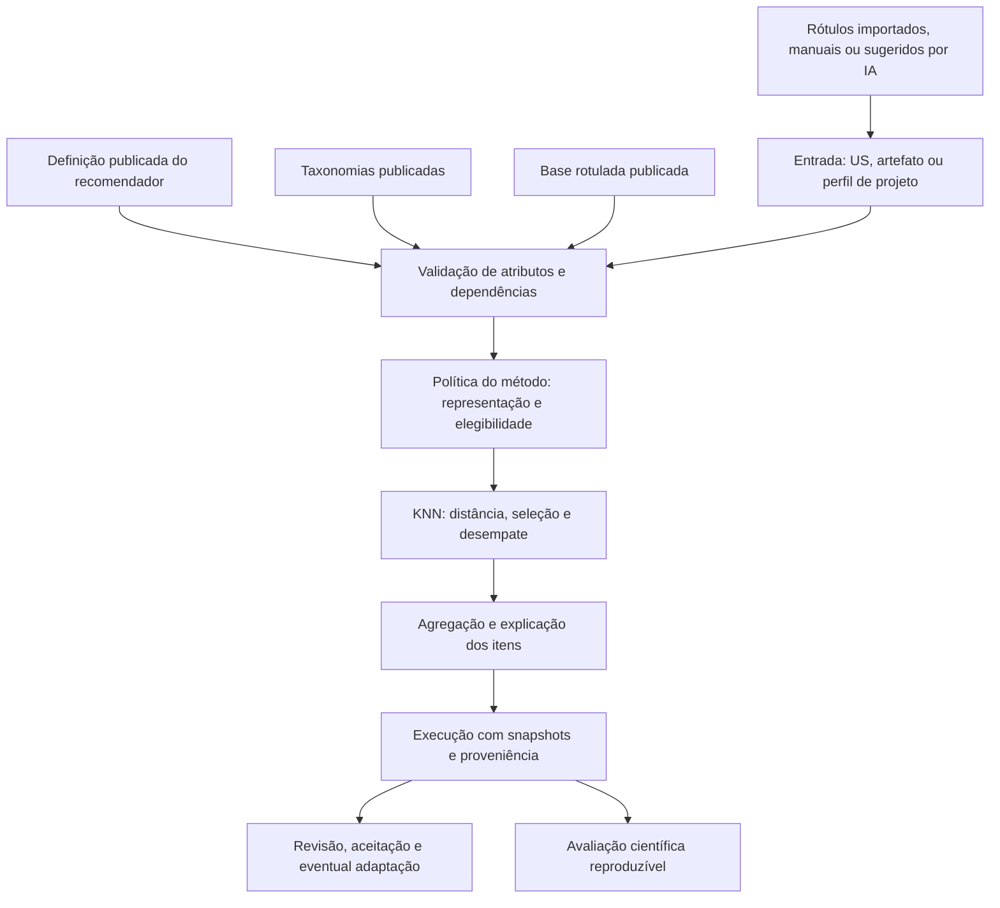
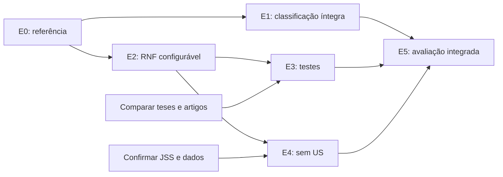

# Plano de evolução do US-Agent

Data: 17/10/2026. Situação: B01/B03/B04 concluídos na [entrega 001](entregas/001-referencia-e-politica.md); B05–B06 e a integração de E1 concluídos na [entrega 002](entregas/002-classificacao-multilabel.md). A ampliação funcional permanece em implementação incremental.

Evoluir o US-Agent para configurar recomendadores de Engenharia de Software, começando pelo RNF de Felipe, acrescentando os casos de teste de Ednaldo e demonstrando um caso sem User Story. A classificação assistida por IA, a decisão sob incerteza, a revisão humana e a evolução supervisionada das taxonomias continuam como capacidades centrais. A generalização deve reaproveitar essas capacidades e o motor existente, preservando o comportamento de cada método de referência.

Este plano atende ao pedido atual do usuário. O documento `US-Agent_Requisitos_e_Lacunas.md` é uma fonte de requisitos e de evidências relatadas; suas propostas de arquitetura, prioridades e aceites não são tratadas como decisões aprovadas pelo professor. Os áudios originais não foram reanalisados nesta etapa.

Leitura complementar: [workflow e backlog](workflow-evolucao-us-agent.md) e [referências e fidelidade metodológica](referencias-e-fidelidade.md).

## 1. Ponto de partida conferido

A inspeção considera o HEAD `9ddbcb3594bcc392f89f85f805f6cf71e3850577` **e o conteúdo local com alterações em andamento**. O relatório recebido analisa outro commit, `ab06cbcdf7c54a8e478f05eeaaf224d437f27cc0`; portanto, suas lacunas precisam ser revalidadas. Este plano não atribui o conteúdo local ao deploy e não constitui uma nova auditoria de produção.

O quadro seguinte preserva o diagnóstico inicial. As lacunas de múltiplos rótulos e métricas web foram tratadas na entrega 002; as demais continuam conforme os estados do workflow.

| Tema | Evidência local atual | Encaminhamento |
| --- | --- | --- |
| Motor RNF | `nfr-engine.ts` declara `ramos_2019_manhattan_k1_v2`; há teste da tabela 5.7, dimensões do alvo, k=1 e ausência de troca de vizinho. | Congelar essa versão como referência de compatibilidade antes de extrair o núcleo. |
| Catálogos de Felipe | Existem catálogos extraídos, scripts de extração e exemplo publicado reconstruído. São alterações locais em andamento. | Preservar e revisar sua proveniência; distinguir catálogo, demonstração e dataset experimental. |
| Taxonomia na recomendação RNF | A política atual compara nomes exatos de módulo/operação entre versões, inclusive quando a versão está ausente. | Preservar no adaptador legado. A exigência de mesma versão descrita no relatório já não representa o motor local. |
| Revisão humana | `ReviewPage.tsx` já consulta `reviewContext` e exibe votos, motivos, sugestões e propostas. | Revisar funcionamento e integridade; não recriar a tela como se essa integração faltasse. |
| Classificação web | `ai-classifier.ts` escolhe `winner.row`; persistência e aprovação web gravam um único par. | Corrigir o percurso completo dos múltiplos rótulos. O suporte multi-label do RNF não resolve essa perda na origem. |
| Consenso e incerteza web | `classification-store.ts` persiste consenso como 0/1 e incerteza como `1 - confidence`. O comitê aceita consenso 0,5 se os provedores não pedirem revisão. | Definir e versionar política, métricas reais, empate e quórum; preservar o significado dos registros históricos. |
| Base de referência | `loadProfiles` lê classificações do histórico operacional. | Criar publicação explícita de bases e selecionar uma versão por recomendador. |
| Atributos e taxonomias | Perfil RNF fixo; taxonomia funcional com domínio/módulo/operação e mutações de versões ativas. | Introduzir definições de atributos e taxonomias independentes, com conteúdo publicado imutável. |
| Entrada e saída | Fluxo RNF depende de `classificationId`; casos de teste não têm fluxo ativo. | Tornar o vínculo com US opcional no contrato comum e construir o segundo exemplo completo. |
| Importação | `parseImportedStories` separa por linha/ponto e vírgula, filtra tamanho e limita a 100 textos. | Manter o importador textual e acrescentar importação de dataset com contrato próprio. |

Foram encontrados e consultados os PDFs locais de Felipe (2019) e Ednaldo (2021). A grafia da tese é **Ednaldo Dilorenzo de Souza Filho**. A disponibilidade desses PDFs resolve a pendência de acesso às teses, mas não confirma acesso aos datasets e códigos originais, nem equivalência com os artigos posteriores.

## 2. Compromissos para preservar a essência e a qualidade

1. **IA com supervisão e evidência.** Manter votos, motivos, incerteza, propostas de taxonomia e intervenção humana. Registrar qual motor e qual política realmente executaram cada decisão.
2. **Método científico explícito.** Separar reprodução de referência, adaptações do US-Agent e experimentos de melhoria. Alterações de filtros, pesos, distância ou representação recebem uma versão própria.
3. **Continuidade do RNF.** Manter projetos, sprints, histórias, tarefas, vínculos, IDs e histórico. A extração deve conservar resultados quando entrada e base forem equivalentes.
4. **Generalidade demonstrável.** Um novo atributo deve surgir da configuração. Os exemplos devem compartilhar validação, execução e rastreabilidade; particularidades científicas ficam em políticas identificadas.
5. **Dados e resultados preservados.** Publicação produz uma versão imutável. Revisão humana e adaptação geram novos registros, conservando o resultado bruto.
6. **Qualidade verificável.** Build e testes são condições técnicas; utilidade e fidelidade dependem de dados, protocolo e avaliação. Cada entrega deve produzir as evidências correspondentes.

O primeiro recorte oferece KNN e somente as representações, distâncias e políticas implementadas. A classificação LLM é opcional por atributo. Campos já rotulados, importados ou escolhidos manualmente podem alimentar a recomendação diretamente.

## 3. Arquitetura de evolução proposta

Manter React, Express/TypeScript e PostgreSQL. Extrair o código existente em incrementos, com adaptadores para os contratos legados. O classificador Python continua preservado; sua integração ao experimento deve ter contrato e identificação próprios. A extração do KNN não depende de uma reescrita da classificação.

| Conceito | Contrato mínimo a desenhar |
| --- | --- |
| Definição e versão do recomendador | Nome, entrada, saída, atributos, vínculos de taxonomia, base publicada e política de método. |
| Atributo | ID, tipo, escopo, cardinalidade, obrigatoriedade e papel: característica, filtro, saída ou contexto. Texto livre exige uma representação explícita para participar da distância. |
| Taxonomia e versão | Nós com IDs estáveis, descrições, pais opcionais e regra de seleção. Listas e árvores no primeiro contrato; validação de duplicatas, pais ausentes e ciclos. |
| Base e versão | Fonte, arquivo, autorização de uso, registros identificáveis, atributos, rótulos, associações aos itens e relatório de importação. |
| Artefato de entrada | Valores e proveniência; referência opcional a projeto/US. Não exige sprint ou classificação WIS em casos que dispensam esses dados. |
| Execução | Motor, política, parâmetros, hashes/snapshots, candidatos, motivos de exclusão, vizinhos, itens, estado, duração e versão do software. |
| Avaliação | Julgamento por item e, quando houver adaptação, original, cópia, motivo, autoria e vínculo com a execução. |

Escolhas de implementação a fechar na revisão de arquitetura: formato canônico de hash, limites de arquivo/volume, esquema de saída de cada método, autenticação/autorização e transações de publicação. JSON para configuração/taxonomias e CSV/JSON para bases são propostas iniciais.

Para o legado, criar um mapeamento explícito dos nomes de rótulos para os novos IDs. Equivalência entre versões requer mapeamento versionado. A política histórica de comparação por nome permanece identificada no método legado; uma correspondência mais estrita altera elegibilidade e deve ser uma nova política.

## 4. Entregas e revisões de passagem

As entregas abaixo são marcos de resultado. Cada uma será dividida em mudanças pequenas do [backlog](workflow-evolucao-us-agent.md). Os RF/RQ remetem ao documento recebido.

### E0 — Fixar a referência técnica e científica

**Escopo:** registrar o estado atual, preservar o trabalho local e preparar os contratos de referência. RF12–RF13; RQ01 e RQ03.

**Fazer:** inventariar alterações e exemplos existentes; guardar entrada/base/saída do RNF v2; conferir o teste da tabela 5.7; criar fichas metodológicas das teses; obter e comparar as versões dos artigos. Definir como registrar commit, alterações locais, versão do motor e hashes. Levantar disponibilidade e autorização das bases sem pressupor sua ausência definitiva.

**Revisão:** conferir fontes, cálculos e o que é uma adaptação atual. Revisar a diferença entre o relatório e o código. Estabelecer os cenários de compatibilidade antes da refatoração.

**Concluída quando:** existe uma referência executável do comportamento atual e uma lista explícita das decisões científicas abertas. A referência executável e os contratos mínimos foram entregues em B01/B03; a comparação das publicações e o acesso aos dados continuam em B02.

### E1 — Preservar a decisão sob incerteza em todo o fluxo web

**Escopo:** integridade de classificação, persistência e revisão. RF09 e RF12; RQ01 e RQ03.

**Fazer:** definir uma política web versionada de agregação multi-label, empate, quórum, falha parcial e `n/a`; carregar listas de rótulos no contrato da API e da interface; persistir e revisar a lista completa; gravar o consenso realmente calculado e distinguir confiança de incerteza. Identificar motor, modelos, prompt e política, incluindo a pré-classificação por regras. Não substituir métricas legadas por estimativas retroativas.

**Áreas:** `ai-classifier.ts`, `classification-store.ts`, `routes/api.ts`, tipos compartilhados via contratos, tela de classificação, `ReviewPage.tsx` e documentação do caminho Python.

**Diretriz proposta:** usar a política Python como referência da proposta de decisão sob incerteza. Uma integração ou implementação equivalente em TypeScript exige casos de paridade antes de anunciar o mesmo comportamento. As correções imediatas da web recebem uma política identificada, com fórmulas e limites próprios enquanto houver diferenças.

**Revisão:** exemplos com duas operações, votos 1–1, provedor indisponível, todos indisponíveis, rótulos inválidos e retorno `n/a`. Verificar que aprovação e reclassificação conservam todos os pares finais e o histórico anterior.

**Concluída quando:** a lista não perde elementos entre classificação, banco e revisão; métricas coincidem com os votos; falhas e empates seguem a política registrada. Essa é a condição para usar rótulos previstos na avaliação integrada. Ensaios do recomendador com rótulos de referência podem avançar separadamente.

### E2 — Entregar RNF configurável de ponta a ponta

**Escopo:** primeira configuração utilizável da plataforma. RF01–RF07, RF09 manual/importado, RF10–RF11 e RF13; RQ01–RQ04.

**Fazer em fatias:**

1. Persistir rascunho/publicação de definição, atributos e taxonomias com versões imutáveis. Publicar uma configuração RNF que represente o método atual.
2. Importar base rotulada com mapeamento, prévia e validação por registro/campo; publicar uma versão e selecioná-la explicitamente. Registrar duplicatas e erros, sem descarte silencioso ou reclassificação automática.
3. Extrair representação, filtros, distância, seleção, desempate e agregação do RNF para políticas testáveis. O adaptador RNF conserva o comportamento v2 sobre os mesmos dados. A base explícita pode mudar os candidatos; essa mudança deve aparecer na comparação.
4. Disponibilizar seleção do recomendador, formulário pelos atributos, execução, explicação, histórico e decisões por item, aproveitando componentes atuais.
5. Rodar um ensaio RNF com rótulos de referência e exportar os resultados com o protocolo.

**Áreas:** migrations novas e aditivas, `nfr-engine.ts`, `nfr-recommendations.ts`, `research-inputs.ts`, rotas e contratos, `ResearchProfile.tsx`, `NfrRecommendationsPage.tsx`, `App.tsx` e novos módulos de configuração/base/taxonomia. Os nomes finais serão fechados no desenho dos contratos.

**Revisão:** compatibilidade do RNF, transações, imutabilidade, importação CSV com aspas/quebras de linha, taxonomias inválidas, isolamento de bases e autorização. Comparar caminho antigo e novo em ambiente isolado com os mesmos snapshots.

**Concluída quando:** uma pessoa publica/escolhe uma base e executa RNF sem mudar código de domínio; resultado identifica versões, vizinho, dimensões e estado; decisões são idempotentes. A mesma entrada/base conserva vizinho, similaridade e itens, e há evidência experimental inicial com limites declarados.

### E3 — Configurar e avaliar os casos de teste de Ednaldo

**Escopo:** segundo exemplo completo. RF01–RF07 ampliados, RF09–RF11 e RF13–RF14; RQ01–RQ05.

**Fazer:** fechar a correspondência entre tese e artigo SAC; cadastrar os atributos exigidos, critérios de aceitação padronizados e RNFs de contexto; importar US e associações a casos de teste; implementar a representação e a política de vizinhos do método confirmado; retornar casos com título, passos e demais campos documentados; permitir cópia/adaptação mantendo a origem.

A tese de 2021 escolhe Euclidiana, **k=3 e heurística de desempate pelo número de testes associados**. Módulo/operação participam do vetor do exemplo, diferentemente do filtro rígido no RNF. Não transportar os filtros de Felipe automaticamente. A conversão de distância em similaridade, os detalhes de agregação e a correspondência com SAC precisam da revisão descrita na [matriz de fidelidade](referencias-e-fidelidade.md).

**Revisão:** especialista/fonte científica confere o método; engenharia verifica que o segundo exemplo usa o núcleo comum e que os atributos são configuração. Recalcular manualmente um caso com três vizinhos, empate e item compartilhado. Verificar que a cópia editada não altera o teste de origem.

**Concluída quando:** RNF e testes coexistem com atributos e saídas diferentes, usando o mesmo fluxo de publicação/execução. O teste é recuperado da base com proveniência; a avaliação separa recomendação bruta e adaptação humana. Uma demonstração com dados ilustrativos permanece identificada como tal.

### E4 — Demonstrar recomendação sem User Story

**Escopo:** caso de riscos/tecnologias associado a Ademar. RF08, RF13–RF14; RQ01–RQ05.

**Fazer:** confirmar com a orientação a referência JSS candidata e obter texto/material de reprodução; fechar entrada, atributos, taxonomias, alvo e política. Configurar o formulário sobre um perfil de projeto independente. Implementar somente as extensões do núcleo que o método realmente exigir.

**Revisão:** executar sem US, sprint, `classificationId` ou módulo/operação artificiais. Validar se dados de risco são contexto de entrada, itens recomendáveis ou ambos conforme o método; não antecipar essa decisão.

**Concluída quando:** o terceiro exemplo funciona pela configuração publicada, compartilha infraestrutura e produz execução auditável. Caso a referência permaneça pendente, validar tecnicamente o contrato sem US com dados sintéticos identificados, mantendo a reprodução de Ademar em aberto.

### E5 — Consolidar avaliação, experiência e material acadêmico

**Escopo:** evidência de correção, fidelidade, qualidade e esforço de configuração. RF13–RF14; RQ01–RQ05.

**Fazer:** consolidar protocolos, dados permitidos, scripts, saídas e relatórios; comparar classificação e recomendação separadamente; medir passos, tempo, erros e intervenções no código para configurar os três exemplos. Atualizar arquitetura, tutorial, telas e os textos de artigo/dissertação para refletirem exatamente o software executado.

**Revisão:** executar a reprodução a partir das instruções; conferir todas as alegações, métricas, denominadores, diferenças em relação aos artigos e limitações. Revisar a demonstração com a orientação ao final de cada exemplo, sem acumular todas as dúvidas para esta entrega.

**Concluída quando:** outro pesquisador consegue repetir o ensaio determinístico permitido, identificar os dados e compreender as adaptações. Cada pedido do professor tem demonstração ou pendência justificada e delimitada; nenhuma reprodução pendente aparece como concluída.

## 5. Dependências e prioridade

Ordem de execução preferida: E0 → E1 → E2 → E3 → E4 → E5. A obtenção e comparação de referências começa em E0 e continua ao longo das entregas. Dependências externas do SAC/JSS não impedem preservar o RNF, corrigir métricas ou desenhar bases versionadas.

O calendário será estimado após E0 e os primeiros contratos, com base na disponibilidade real de dados e no tamanho das mudanças. Não há prazo ou meta de acurácia inferidos dos áudios. Cada marco deve ser demonstrável, e não apenas uma soma de infraestrutura concluída.

## 6. Cobertura dos critérios recebidos

| Requisito | Entrega responsável | Evidência de conclusão |
| --- | --- | --- |
| RF01 — Definições versionadas | E2; segunda definição em E3 | Publicar, selecionar e executar duas definições diferentes. |
| RF02 — Atributos personalizados | E2–E3 | Novo campo configurado aparece e é validado sem código específico. |
| RF03 — Taxonomias independentes | E2 | Importação de lista e árvore, falhas localizadas e versão publicada imutável. |
| RF04 — Vínculos atributo/taxonomia | E2–E3 | Atributos distintos usam taxonomias próprias e IDs validados. |
| RF05 — Base rotulada | E2 | Arquivo original, prévia, mapeamento e relatório de importação preservados. |
| RF06 — Seleção/versionamento da base | E2 | Execução consulta somente a versão escolhida; aceitar item não altera o benchmark. |
| RF07 — KNN configurável | E2–E3 | RNF k=1 preservado e política do segundo método explicitada. |
| RF08 — Entrada sem US | E4 | Execução sem dependências artificiais de história/classificação. |
| RF09 — Origem dos rótulos | E1–E2; integração por atributo em E3 | Importado/manual/IA identificados; automação opcional. |
| RF10 — Execução e explicação | E2–E4 | Vizinhos, representação, distância, itens, versões e estados distintos. |
| RF11 — Decisão e adaptação | E2; adaptação em E3 | Aceitar/rejeitar idempotente; original e versão adaptada preservados. |
| RF12 — Classificação fiel | E1 | Múltiplos rótulos, votos, quórum, métricas e revisão coerentes. |
| RF13 — Avaliação reproduzível | E0/E2–E5 | Protocolo, splits, snapshots e exportação; falhas e vazios incluídos. |
| RF14 — Três exemplos | E3–E5 | Pacote de definição, taxonomias, base, entrada, execução e avaliação por exemplo. |
| RQ01 — Rastreabilidade | Todas | Identidades, versões, hashes e proveniência disponíveis. |
| RQ02 — Transações | E2–E4 | Importação/publicação inválida não deixa conteúdo parcialmente publicado. |
| RQ03 — Compatibilidade | E0–E2 | IDs, vínculos e histórico preservados; mesma entrada/base conserva o RNF. |
| RQ04 — Proteção e autoria | E2; revalidar E3–E4 | Acesso e alteração autorizados; isolamento verificado antes de dados empresariais. |
| RQ05 — Esforço e desempenho | Piloto E2; consolidar E5 | Tempo, erros, passos, volume e duração medidos, com metas após piloto. |

## 7. Protocolo de qualidade a incorporar às entregas

Situação após B12c: o vertical RNF foi percorrido em navegador, desde configuração e importação até execução, avaliação, histórico e replay. A [interface](recomendadores-web.md) preserva versões, hashes e decisões separadas do resultado original. Destinos operacionais exigem escolha, revisão e justificativa explícitas. B12 está tecnicamente verificado no recorte implementado; acesso por pessoa/organização (B13), políticas dos demais métodos e avaliação empírica permanecem pendentes. A [lista de pendências](pendencias-e-proximos-passos.md) distingue esses limites.

| Dimensão | Como avaliar | Limite da conclusão |
| --- | --- | --- |
| Correção técnica | Casos calculáveis manualmente; filtros, distâncias, empates, múltiplos rótulos, faltantes, zero similaridade, vazios, idempotência e rollback. | Confirma implementação para os cenários cobertos. |
| Fidelidade | Matriz fonte/seção/regra/configuração/teste/desvio para cada método. | Uma reconstrução de tabela não demonstra equivalência com o sistema original. |
| Recomendação | Precisão, revocação, F1 e cobertura; F2 para o estudo de Ednaldo conforme protocolo confirmado. Ranking quando houver ordenação relevante. Registrar falhas e ausência de itens. | Precisão/recall exigem referência de relevância e regra de correspondência dos itens; aceitação humana é medida separada. |
| Classificação | Precisão/recall/F1 micro e macro por rótulo, conjunto exato, cobertura e taxa de revisão; recomendação com rótulos de referência versus previstos. | Quantifica propagação de erro; não mistura os motores web/Python. |
| Configurabilidade | Configurar os três exemplos e registrar passos, tempo, erros e mudanças de código necessárias. | Três telas específicas não bastam para demonstrar generalidade. |
| Operação | Duração, volume, falhas e custos de provedores quando utilizados. | Definir metas após o piloto; não anunciar SLA sem medição. |

O manifesto de cada ensaio deve conter: commit/estado da árvore, motor e parâmetros, arquivos e hashes, definição e dependências publicadas, IDs dos alvos, particionamento, sementes, regra de relevância, métricas e convenções para divisões por zero, ambiente e saídas por alvo. Preservar contagens TP/FP/FN e distinguir médias micro/macro. Sugestão: reportar precisão indefinida em retorno vazio e revocação indefinida sem itens de referência como `N/A`, contabilizando os casos; fechar a convenção antes do ensaio.

Separar por projeto quando o protocolo exigir e manter associações esperadas fora da base consultada. Evitar vazamento por clones de histórias/testes entre partições. Seleção de k e outras escolhas não usam o conjunto final de teste. Reprodução do protocolo original e avaliação adicional com controles diferentes recebem nomes próprios. Estimativas de variabilidade devem respeitar o agrupamento por projeto e o tamanho disponível; não prometer significância sem dados adequados.

## 8. Riscos e decisões abertas

| Risco/pendência | Ação e efeito sobre o trabalho |
| --- | --- |
| Tese e artigo podem divergir | Comparar versão por versão antes de publicar o perfil científico. Prosseguir com infraestrutura e testes do legado. |
| Código/dados originais ainda não confirmados | Catalogar o acesso encontrado e solicitar os materiais por canal autorizado pelo usuário. Sem eles, entregar demonstração técnica com limite explícito. |
| Ambiguidades numéricas na tese de Ednaldo | Registrar questões e verificar artigo/código; implementar fórmulas testáveis com decisões identificadas, sem alegar reprodução exata antecipadamente. |
| Refatoração muda candidatos ou itens | Comparação sobre snapshots idênticos, migração aditiva, adaptador e ativação gradual. Divergência intencional exige nova versão. |
| Generalização excessiva | Expandir representações e políticas quando um exemplo confirmado exigir. Manter um núcleo pequeno e adaptadores claros. |
| RNF recuperado pode ser inadequado ao alvo | Mostrar origem e resultado bruto; julgamento/adaptação humana separados. Não alterar sentenças silenciosamente para melhorar o experimento. |
| Mistura de feedback com benchmark | Aceitação não retroalimenta a base publicada; incorporação exige nova versão e auditoria. |
| Autoria não equivale a autorização | Revisar autenticação e autorização antes de bases empresariais; definir se o recorte será individual ou com isolamento organizacional. |

Situação após B15b, seguindo a [revisão de escopo](revisao-de-escopo.md): [avaliação RNF local](avaliacao-rnf.md) reproduzível, [contrato E21](testrec-contrato-dados.md), [demonstração local das equações](testrec-equacoes-demonstracao.md) e [catálogos de testes publicados](catalogos-casos-teste.md), sem alterar as oito saídas RNF. A [conferência de aderência](aderencia-demandas-professor.md) registra direção correta e atendimento ainda parcial. Próxima frente: ligar catálogo, importação da base e execução comum do segundo método com identidade/regras explícitas, fontes/dados e acompanhamento Q01/Q02; acompanhar protocolo empírico RNF e terceiro caso. B14 ainda não conclui avaliação real/configuração humana; B16a não reproduz a configuração Euclidiana e B15b não publica TestRec. B13b/B13c continuam pendentes antes de bases restritas/empresariais ou uso multiusuário protegido.
