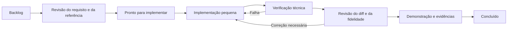

# Workflow e backlog de evolução do US-Agent

Data inicial: 17/10/2026. Usar com o [plano](plano-evolucao-us-agent.md) e a [matriz de fidelidade](referencias-e-fidelidade.md).

Este roteiro acompanha trabalho planejado e implementado. “Planejado” não significa implementado, e uma capacidade existente só é considerada verificada após a evidência indicada. As entregas registram as mudanças, verificações e limitações de cada incremento.

## 1. Ciclo de cada mudança



Manter uma mudança em implementação por vez como preferência de organização, sem exigir trabalho com agentes paralelos. Buscar fontes e resolver pendências externas pode continuar enquanto uma entrega técnica avança. Limitar cada mudança a um comportamento revisável, incluindo contrato, implementação e evidência correspondente.

| Momento | Revisão e resultado esperado |
| --- | --- |
| Antes de implementar | Requisito/RF e fonte identificados, comportamento atual/esperado, dependências, aceite observável e efeito sobre o legado. Para mudanças científicas, preencher a ficha do método. |
| Durante a implementação | Alterar contratos, persistência e consumidores de forma coerente; manter migrações aditivas e adaptadores. Introduzir teste quando houver regra ou risco relevante, especialmente no motor e nos dados. |
| Verificação técnica | Rodar checks proporcionais ao impacto. Examinar falhas, estados vazios, transações, proveniência e compatibilidade. Registrar o que foi e o que não foi executado. |
| Revisão do diff | Conferir escopo, legibilidade, validação, acesso e preservação de dados. Mudança que altera método revisa também fonte, fórmula e versão. Uma segunda pessoa pode revisar quando disponível; a revisão científica fica registrada à parte. |
| Demonstração | Mostrar um caso representativo do início ao resultado e seu histórico. Atualizar tutorial, matriz RF/aceite, ficha metodológica e próximos itens. |
| Fechamento | Aceite atendido, evidências anexadas, limitações declaradas e próxima mudança definida. Apresentar o resultado da entrega à orientação; registrar ajustes solicitados. |

Revisões da orientação são checkpoints de método e aderência ao pedido. Dúvidas científicas localizadas suspendem a alegação de reprodução daquele método; os demais itens independentes continuam.

## 2. Backlog ordenado

Dependências indicam precedência técnica mínima. A ordem preferida é a do plano; itens de fontes começam cedo e podem permanecer pendentes sem bloquear a infraestrutura. A [entrega 001](entregas/001-referencia-e-politica.md) registra a primeira implementação e seus limites.

Após a [revisão de escopo](revisao-de-escopo.md), B14 prioriza a avaliação com dados locais sintéticos ou públicos autorizados; B14a entrega seu piloto técnico, e a avaliação empírica permanece pendente. B13b/B13c continuam obrigatórios antes de bases restritas/empresariais ou uso multiusuário protegido; não bloqueiam esse trabalho local. Preservar B13a e priorizar avaliação e os outros exemplos, conforme os pedidos centrais relatados.

| ID | Entrega / RF-RQ principal | Trabalho e evidência esperada | Depende de | Estado atual |
| --- | --- | --- | --- | --- |
| B01 | E0 / RQ03 | Inventariar alterações locais, preservar exemplo RNF v2 e registrar os snapshots entrada/base/saída com versão e hashes. | — | Concluído: oito cenários congelados, manifesto e comando de verificação |
| B02 | E0 / RF13–14 | Consolidar fichas F19/E21, comparar F25/E26 e identificar dados/código permitidos; resolver Q01–Q05 ou registrar bloqueios por método. | — | Em andamento: B02g produz derivação legível e revisão visual; B02h materializa conciliação literal/fila verificável sem inferências (entrega 026). Relações/campos/catálogo/recorte/código/folds, Q01/Q03 e CT05 residual em Q02 exigem fonte adicional; F25/Ademar precisam de complementação. Avançar configurabilidade/material dos outros casos de forma independente |
| B03 | E0 / RQ01–03 | Fechar arquitetura mínima, contratos, estados de publicação, estratégia de migração e cenários de compatibilidade. | B01 | Concluído: ADR 001 e referência de compatibilidade; contratos genéricos serão implementados em B07–B12 |
| B04 | E1 / RF12 | Especificar política web multi-label, quórum, empates e falhas; criar exemplos de decisão e versão de política. | B01 | Concluído: ADR 002 e módulo testado; integrado em B05–B06 e reverificado na entrega 003 |
| B05 | E1 / RF12 | Preservar lista de rótulos na classificação, API, banco e revisão; verificar dois pares de ponta a ponta. | B04 | Concluído: integração e testes na entrega 002 |
| B06 | E1 / RF09, RF12 | Persistir métricas reais e proveniência de motor/modelos/prompt/política; distinguir registros legados e regras locais. | B04–B05 | Concluído: proveniência imutável, métricas reais e snapshots de revisão; migration 016 aplicada localmente |
| B07 | E2 / RF01–02, RF10 | Criar contratos/validação de definição e atributos; executar configuração RNF em memória com adaptador do motor v2. | B03 | Concluído: contratos, configuração RNF executável e oito comparações integrais; entrega 003 |
| B08 | E2 / RF03–04, RQ01–02 | Publicar taxonomias independentes e ligá-las aos atributos; validar listas/árvores, ciclos e IDs. | B07 | Concluído: backend na entrega 004; mapeamentos em B11 e editor/publicação web em B12b |
| B09 | E2 / RF01, RQ01–02 | Persistir/publicar definição com dependências imutáveis; tentativa de alterar publicação gera nova versão. | B08 | Concluído no backend: pacote e vínculos imutáveis, publicação transacional e checks de concorrência; entrega 005 / ADR 003 |
| B10 | E2 / RF05–06, RF09 | Importar CSV/JSON com mapeamento e prévia; publicar dataset rotulado com relatório, origem, autoria e hash. | B09 | Concluído: backend na entrega 006 e importação/publicação web em B12b, verificada em navegador em B12c |
| B11 | E2 / RF06–07, RQ03 | Extrair políticas do KNN e selecionar base explícita; comparar legado e novo motor sobre entrada/base idênticas. | B10 | Concluído no backend: política separada, seleção explícita, mapeamentos e execuções com replay; entrega 007 |
| B12 | E2 / RF01–02, RF10–11 | Entregar fluxo RNF: configurar, escolher base, preencher, executar, explicar, avaliar e consultar histórico. | B11 | Concluído tecnicamente no recorte RNF: B12a–B12c, decisões imutáveis e vertical verificado em Edge desktop/mobile; entrega 010. Aprovação científica e estudo de usabilidade permanecem separados |
| B13 | E2 / RQ04 | Revisar autenticação/autorização, autoria, isolamento e alertas das dependências existentes; implementar o recorte definido e verificar acessos cruzados. | B03; concluir antes de bases empresariais | Em andamento: B13a fecha o perímetro HTTP e corrige os alertas npm; B13b (pessoas/sessões/papéis) e B13c (organizações/auditoria) pendentes. Entrega 011 e ADR 005 |
| B14 | E2 / RF13, RQ05 | Executar piloto RNF com referência, exportação e protocolo; medir configuração e duração, fixando convenções/metas posteriores. | B12; B13 se dados restritos | Em andamento: B14a entrega avaliador sintético e B18b prepara instrumento/protocolo proposto de esforço (entrega 027). Avaliação empírica, protocolo/material de estudo, coleta humana e volume representativo pendentes |
| B15 | E3 / RF02–04, RF14 | Fechar ficha Ednaldo, definir esquema de casos de teste e importar critérios/associações com a fonte disponível. | B02, B10 | Em andamento: B15a valida contrato E21 e tabela 4.6; B15b publica catálogos persistidos com arquivo original e versões imutáveis, entrega 015. B15c integra importação/publicação de associações com catálogo exato, entrega 017. Catálogos/associações originais pendentes |
| B16 | E3 / RF07, RF10 | Implementar política confirmada de testes: representação, distância, k, heurística, agregação e ranking. | B11, B15 | Em andamento: B16a demonstra equações explícitas E21, KNN compartilhado e ranking sintético local; entrega 014. B16b integra a demonstração sintética ao executor/publicações comuns, entrega 017. Configuração Euclidiana e dados originais pendentes |
| B17 | E3 / RF09–11, RF14 | Disponibilizar segundo recomendador no mesmo fluxo; copiar/adaptar teste mantendo origem, sem reclassificar base importada. | B12, B16 | Concluído tecnicamente no recorte demonstrativo: B17a interface e B17b avaliações/cópias versionadas, entregas 018–019. Destino na entrada preservada; confirmação científica e avaliação empírica permanecem separadas |
| B18 | E3 / RF13–14, RQ05 | Avaliar segundo exemplo com protocolo confirmado e medir esforço de configuração; revisar com a orientação. | B17 | Em andamento: B18a prepara avaliador; B18b entrega instrumento; B18c fornece roteiros/arquivos; B18d verifica ambos no navegador local, incluindo histórico/replay/exportação (entrega 029). Faltam vínculo final protocolo/material/analisador, decisões metodológicas, referência/dados de avaliação e coleta observada. A instalação da coleta deve ser conferida antes do estudo |
| B19 | E4 / RF08, RF14 | Confirmar referência JSS/material; preencher ficha do método e identificar atributos, alvo e dados autorizados. | — | Referência candidata localizada |
| B20 | E4 / RF08, RF10 | Configurar entrada independente de US, aplicar política confirmada e executar sem IDs ou rótulos artificiais. | B12, B19 | Planejado |
| B21 | E4 / RF13–14 | Avaliar e demonstrar exemplo sem US; se faltarem dados, delimitar demonstração e reprodução pendente. | B20 | Planejado |
| B22 | E5 / RF13, RQ01–05 | Rodar protocolo integrado, incluindo comparação de rótulos de referência/previstos e efeito das revisões. | B06, B14, B18, B21 | Planejado |
| B23 | E5 / RF14, RQ05 | Consolidar pacotes reproduzíveis, arquitetura, tutorial, esforço de configuração e evidências do artigo/dissertação. | B22 | Planejado |

B07–B12 devem produzir demonstrações progressivas: configuração RNF executável → publicação recuperável → base importada → fluxo completo. Cada item poderá ser subdividido em mudanças menores quando o contrato estiver definido. B13 entra no desenho inicial e não fica para depois da exposição dos dados.

## 3. Critérios para considerar uma mudança pronta

- O comportamento esperado foi demonstrado e o RF/RQ correspondente tem evidência.
- A revisão científica identificou fonte, regra e desvios quando o método foi afetado.
- O RNF de referência continua compatível sobre os mesmos snapshots, ou a divergência intencional recebe uma nova versão identificada.
- Importação/publicação inválida não deixa conteúdo incompleto; revisões não apagam originais; decisões repetidas preservam integridade.
- Foram executados os checks apropriados e registradas limitações. Ausência de testes de interface não é evidência de cobertura da interface.
- Documentação, contratos e roteiro de demonstração refletem o comportamento entregue.

## 4. Checkpoints de cada marco

| Marco | Demonstração para revisão | Pergunta que a evidência precisa resolver |
| --- | --- | --- |
| E0 | Exemplo RNF, inventário e ficha de referências | Sabemos o que preservar e quais decisões dependem de fontes? |
| E1 | US com dois pares, empate e falha parcial; consulta de votos e métricas | O sistema mantém e explica a decisão real até a revisão? |
| E2 | Publicar configuração/base e executar RNF com histórico | RNF tornou-se uma instância configurada, mantendo o método declarado? |
| E3 | Configurar testes com outros atributos, executar e adaptar uma cópia | O segundo caso reutiliza o núcleo e segue a referência identificada? |
| E4 | Perfil independente recebe recomendações rastreáveis | O núcleo funciona sem dependência artificial de US? |
| E5 | Repetir ensaio e localizar cada resultado no relatório | As alegações acadêmicas são sustentadas pelos dados e pelo software executado? |

## 5. Checks e situação de partida

Comandos existentes para a referência técnica:

```powershell
npm.cmd test
npm.cmd run build
npm.cmd run check:nfr-baseline
npm.cmd run evaluate:rnf
npm.cmd run check:rnf-evaluation
npm.cmd run check:configured-nfr
npm.cmd run check:recommender-taxonomies
npm.cmd run check:recommender-definitions
npm.cmd run check:recommender-datasets
npm.cmd run check:recommendation-runs
npm.cmd run check:recommender-browser
npm.cmd run check:classification-workflow
```

Verificações com banco, a executar somente no ambiente local isolado e com dados de demonstração adequados:

```powershell
node scripts/check-nfr-recommendations.mjs
npm.cmd run db:check:ramos
```

O primeiro script requer o build e cria um schema temporário no PostgreSQL local. O segundo espera que o exemplo Ramos já exista. Não são validadores das bases científicas completas. Evitar usar migração/seed como uma etapa automática de revisão documental.

Registro da verificação de 17/10/2026:

| Check | Situação |
| --- | --- |
| Suíte API | 18 testes passaram, incluindo a tabela 5.7 e regras de compatibilidade do RNF. |
| Suíte web | Comando concluiu com sucesso, mas não encontrou arquivos de teste (`--passWithNoTests`). A cobertura de interação ainda precisa ser construída nos fluxos críticos. |
| Build | API e web compilaram com sucesso (`npm.cmd run build`). |
| HTTP/persistência com PostgreSQL | Não executado nesta etapa de planejamento. |
| Experimento de qualidade científica | Não executado nesta etapa; testes unitários não substituem essa avaliação. |

Os comandos inicialmente encontraram uma restrição de diretórios do sandbox no Vite e foram repetidos fora dele após a autorização da ferramenta. O resultado final, não a falha de ambiente inicial, deve compor a referência técnica.

Na [entrega 001](entregas/001-referencia-e-politica.md), a suíte API passou a 32 testes, os oito cenários congelados foram verificados e o build completo passou. A suíte web continua sem arquivos de teste. Os resultados da tabela acima preservam o registro da inspeção inicial; a entrega contém a verificação atualizada.

## 6. Modelo de registro por mudança

```text
ID e título:
Entrega / RF / RQ:
Estado: backlog | análise | pronto | implementação | revisão | concluído
Comportamento atual e comportamento esperado:
Referência científica, seção e versão:
Adaptação do US-Agent e justificativa, se houver:
Dependências e decisão pendente:
Arquivos/contratos afetados:
Migração, compatibilidade e reversão, quando aplicável:
Critério de aceite e caso de demonstração:
Checks executados e evidências:
Revisão técnica: pessoa/data/resultado
Revisão científica: fonte ou pessoa/data/resultado
Limitações:
Próximo item:
```

Na [entrega 002](entregas/002-classificacao-multilabel.md), B05–B06 foram concluídos: 38 testes da API, sete testes de interface, build e checks HTTP passaram; a migration 016 foi aplicada somente no banco local, preservando os dados anteriores verificados.

Na [entrega 003](entregas/003-verificacao-e-contratos-configuraveis.md), as entregas anteriores foram reverificadas e B07 foi concluído: 51 testes da API passaram e o novo caminho reproduziu os oito resultados congelados. O [contrato executável](recomendadores-configuraveis.md) delimita a simulação em memória e o que ainda depende de publicação, importação e interface.

Na [entrega 004](entregas/004-taxonomias-e-pendencias.md), B07 foi reverificado e B08 foi concluído no backend: 57 testes da API, sete da interface, build e checks HTTP passaram. A migration 017 foi aplicada somente no banco local, preservando conteúdo e contagens das 33 tabelas anteriores. O novo check publica os dois catálogos e compara os oito resultados RNF com suas dependências preservadas.

Na [entrega 005](entregas/005-publicacao-definicoes.md), B09 foi concluído no backend: 60 testes da API, sete da interface, build e checks HTTP passaram. A migration 018 foi aplicada somente no banco local e as 34 tabelas anteriores mantiveram contagens e hashes. A [ADR 003](decisoes/003-publicacao-definicao-e-base.md) distingue dependências fixadas na definição da base a selecionar em cada execução.

Na [entrega 006](entregas/006-importacao-bases.md), B10 foi concluído no backend: 69 testes da API, sete da interface, build e checks HTTP passaram. A migration 019 preservou contagens/hashes das 36 tabelas anteriores no banco local. O novo check importou/publicou as bases dos oito cenários RNF sem alterar seus resultados.

Na [entrega 007](entregas/007-execucao-base-explicita.md), B11 foi concluído no backend: 75 testes da API, sete da interface, build e checks HTTP passaram. As oito execuções persistidas mantiveram os resultados congelados, e a migration 020 preservou as 38 tabelas anteriores no banco local. O [contrato de execução](execucoes-configuraveis.md) descreve seleção de dependências, mapeamentos e replay.

Na [entrega 008](entregas/008-execucao-configuravel-web.md), B12a acrescentou o fluxo web sobre versões já publicadas: 75 testes da API, 26 da interface, build e check HTTP/PostgreSQL passaram. O [roteiro web](recomendadores-web.md) descreve acesso, seleção, formulário, explicação e replay. A verificação visual/manual e o aceite integral de B12 permanecem pendentes.

B12 foi subdividido em B12a (seleção/execução/histórico), B12b (editores/publicação e importação) e B12c (decisões persistidas e fechamento técnico em navegador), concluídos no recorte RNF.

Na [entrega 009](entregas/009-configuracao-importacao-web.md), B12b acrescentou editores, vínculos/mapeamentos científicos e importação CSV/JSON com prévia e exclusões: 75 testes da API, 39 da interface, build e quatro checks HTTP/PostgreSQL passaram. A publicação web fixa o hash do rascunho revisado. Nenhuma migration ou fórmula RNF foi alterada.

Na [entrega 010](entregas/010-avaliacoes-e-vertical-rnf.md), B12c acrescentou destinos explícitos, aceitação/rejeição imutável e deduplicação transacional: 77 testes da API, 45 da interface, build e checks HTTP passaram. O percurso completo foi executado no Edge headless, com capturas desktop/mobile inspecionadas. A migration 021 preservou as 39 tabelas anteriores no banco local.

Na [entrega 011](entregas/011-perimetro-e-dependencias.md), B13a centraliza a proteção de todo `/api`, restringe o desenvolvimento local e as origens, mantém as integrações Python autenticadas e corrige as dependências sinalizadas. A [ADR 005](decisoes/005-perimetro-e-identidade.md) separa a barreira técnica da identidade pessoal e do isolamento organizacional.

Na [entrega 012](entregas/012-avaliacao-rnf-reproduzivel.md), B14a acrescenta protocolo e executor de avaliação local: oito comparações de compatibilidade, cinco cenários com anotações sintéticas separadas, contagens/métricas, exportação e replay. Não constitui avaliação empírica do RNF ou medição de configuração com participantes.

Na [entrega 013](entregas/013-contrato-ednaldo-e-aderencia.md), B15a inicia o segundo exemplo com contrato de dados, catálogo local e quatro vetores da tabela 4.6 da tese E21. Não calcula similaridade/ranking nem declara o TestRec executável. A [revisão de aderência](aderencia-demandas-professor.md) confirma a direção e registra o atendimento ainda parcial.

Na [entrega 014](entregas/014-equacoes-ednaldo.md), B16a executa localmente as equações 4.2/4.3 de E21, reutilizando o KNN e distinguindo regras da fonte de adaptações técnicas. Ranking, contribuições, catálogo e replay usam somente associações sintéticas; a tabela 4.5 continua bloqueada por associações ausentes. Q02 foi delimitada ao CT01; CT04 coincide com a equação. Não conclui a política Euclidiana ou a integração TestRec.

Na [entrega 015](entregas/015-catalogos-testes-publicados.md), B15b publica catálogos de testes por API, preservando arquivos originais e versões imutáveis. Referências exatas, concorrência, rollback, retirada, histórico e autorização foram verificados no PostgreSQL local. A migration 022 preservou as 42 tabelas anteriores; ainda não há execução TestRec persistida ou interface de catálogo.

Na [entrega 016](entregas/016-rebase-idioma-e-preservacao.md), a pedido do usuário, `development` foi atualizada pelo rebase, integrando inglês e fluxos de projetos do remoto. As adições configuráveis, múltiplos rótulos, revisão detalhada e evidências permaneceram preservadas. Testes/builds/HTTP/navegador foram reverificados, e `.gitattributes` protege as fontes/artefatos contra conversão de finais de linha. Não altera o estado científico de B15/B16.

Próxima frente após B02c/E26: preparar transformação auditada dos CSVs públicos, resolver campos/identidades e confirmar recorte, catálogo e código/folds; a [revisão E26](revisao-artigo-ednaldo-e26.md) registra bloqueios concretos. O [avaliador técnico](avaliacao-testes.md) já verifica cenários artificiais; B18 continua em andamento, incluindo protocolo de configuração com participantes ainda em preparação. Q01–Q03 permanecem abertas. Dados/protocolo empírico de Felipe e fonte Ademar seguem em acompanhamento. Preservar a distinção entre demonstração e reprodução científica. B13b/B13c continuam condicionantes do uso protegido de bases restritas/multiusuário. A [lista de pendências](pendencias-e-proximos-passos.md) distingue desenvolvimento, avaliação científica e revisões da orientação.

Atualização B02d: a [entrega 022](entregas/022-preparacao-rastreavel-ednaldo.md) prepara revisão por faixas de bytes/contexto e rascunho rastreável dos critérios. Próxima ação: revisar os limites dos registros e registrar somente reparos comprovados, com decisões explícitas sobre perfis e recorte. Nenhum CSV foi limpo por suposição e nenhuma população científica foi inferida das linhas isoladas.

Atualização B02e: a [entrega 023](entregas/023-normalizacao-reversivel-transporte.md) aplica plano literal limitado a seis unidades isoladas, com inversão exata e preservação de todo conteúdo de célula sob essa convenção. Próxima ação: revisar as 51 unidades restantes e os limites/valores ainda ambíguos; localizar código/recorte e manter pendentes aliases sem confirmação. A derivação não torna a base apta a ensaio empírico.

Atualização B02f: a [entrega 024](entregas/024-comparacao-versoes-ednaldo.md) preserva/compara o registro anterior 16133229 e a resposta com três versões do depósito. Vinte IDs e nove grupos multilinha ganham evidência adicional, sem reposição automática. Próxima ação: revisar candidatos e declarar versão adotada ou derivação, mantendo dados e métodos anteriores separados e reexecutáveis.

Na [entrega 017](entregas/017-testes-no-executor-comum.md), B15c/B16b publicam a demonstração E21 no executor comum: importações/bases/execuções schema 2, catálogo fixado, cinco estados representativos e replay após retirada. Passaram 106 testes API, 47 web e builds; a migration 023 preservou as 43 tabelas locais. `npm.cmd run check:testrec-runs` verifica HTTP/PostgreSQL; `--replay docs/evidencias/b16b/published-runs.json` verifica o pacote offline. B17 permanece pendente; a interface RNF indica métodos API-only.

Na [entrega 018](entregas/018-interface-casos-teste.md), B17a acrescenta a interface da demonstração E21: revisão/publicação de catálogo, template/atributos, taxonomia independente, importação/exclusões, escolha de base/catálogo, formulário sem respostas de teste, resultado/contribuições, histórico/replay e download. Passaram 58 testes web, build e percursos reais no Edge para E21 e RNF. Nenhuma migration ou fórmula foi alterada. B17b avaliação/cópias específicas permanece pendente, assim como Q01/Q02 e avaliação empírica.

Na [entrega 019](entregas/019-revisao-plano-e-avaliacoes-testes.md), o plano foi revisto e B17b acrescenta decisões imutáveis, destino explícito na entrada e cópias versionadas de título/Gherkin com motivo/origem. Passaram 109 testes API, 61 web, builds, HTTP com concorrência/rollback e percurso Edge até histórico/replay após retirada. Migration 024 local preservou as 43 tabelas anteriores e criou três tabelas de avaliação. Próximo foco: preparação B18 e acompanhamento de fontes/dados/B19; nenhuma dessas verificações conclui qualidade empírica ou aprovação do professor.
